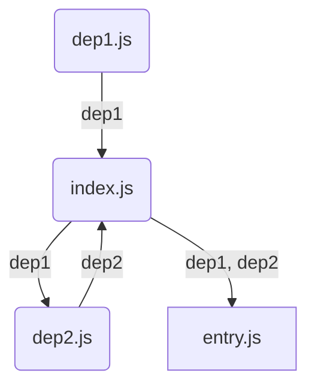
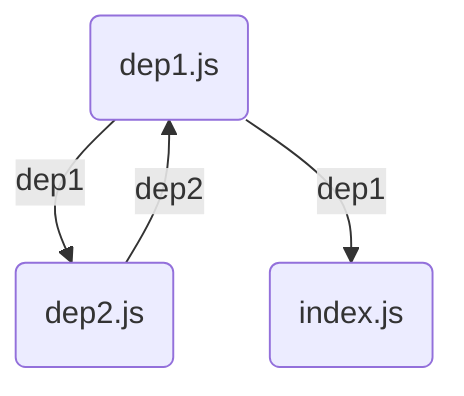
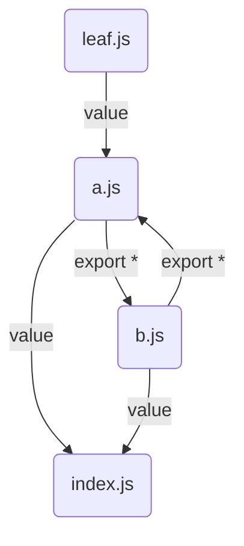

- `test1` - `test5`

Cyclic import example based on https://github.com/vitejs/vite/issues/14048#issuecomment-2354774156

---

- `test6`

---

- `test10` - `test11`

`export *` from a module that is still evaluating in a cycle (https://github.com/vitejs/vite/issues/24183).
`b.js` must also get the `value` export that `a.js` gets later through `export * from './leaf.js'`.
In `test11`, `b.js` re-exports `a.js` through `c.js`.

